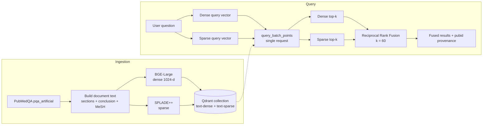

# 🧠 PubMedQA Hybrid Search – Dense (BGE) + Learned-Sparse (SPLADE++) Retrieval with Reciprocal Rank Fusion

> **Goal:**
> Make it immediately clear **what problem the system solves, why hybrid retrieval is required, how it ranks, and how success is measured**.


-6E40C9)


-orange)


[](https://colab.research.google.com/github/<your-username>/pubmedqa-hybrid-search/blob/main/PubMedQA_Hybrid_Search.ipynb)

**Stack at a glance:** `BGE-Large (dense, 1024-d, cosine)` · `SPLADE++ (learned sparse, inverted index)` · `Qdrant named vectors` · `FastEmbed (ONNX, CPU)` · `Reciprocal Rank Fusion` · `PubMedQA (211,269 abstracts; 100 used)` · `BM25 as the lexical baseline SPLADE improves on`

---

## 1️⃣ Project Title & Value Proposition

**Hybrid Biomedical Retrieval Engine for AI engineers and RAG builders, returning evidence that matches both the *meaning* and the *exact terminology* of a clinical question.**

| | |
|---|---|
| **Agent/system type** | Hybrid retrieval layer (dense + learned-sparse + rank fusion), the evidence-fetching tool a biomedical RAG system or research agent calls |
| **Primary user** | ML/AI engineer building a biomedical RAG assistant or literature-search tool |
| **Outcome** | Natural-language clinical question → ranked, traceable PubMed abstracts that neither a pure-semantic nor a pure-keyword retriever would rank as well on its own |

---

## 2️⃣ Background & Problem Context

- **Real-world context:** Clinicians, systematic reviewers, pharma R&D and medical-affairs teams search biomedical literature daily. PubMed holds 35M+ citations. Users ask questions in plain language (*"Does X improve Y in patients with Z?"*); abstracts are written in dense technical vocabulary (drug names, gene symbols, acronyms, MeSH headings).
- **Who feels the pain:** Anyone whose downstream answer depends on retrieval quality. In RAG, an LLM can only reason over what retrieval gives it, so missed evidence or look-alike evidence becomes a wrong or ungrounded answer.
- **Why it is hard at scale:**
  - **Vocabulary mismatch:** users say *"heart attack"*, papers say *"myocardial infarction"*. Exact-match search (BM25) misses it.
  - **Entity blur:** embedding models place `FGFR2` near `FGFR3`, or *metformin* near *"other antidiabetic drugs"*. Pure dense search cannot reliably pin down rare entities.
  - **Score incompatibility:** in this project's own output, the same top document scored **0.68** on the dense side (cosine) and **11.87** on the sparse side (SPLADE dot product). The two scales cannot simply be added.
- **What breaks with simple approaches:** one retriever fixes only one failure mode; hand-tuned score blending (`0.7·dense + 0.3·sparse`) is fragile and needs re-tuning whenever the model, corpus or query mix changes.

---

## 3️⃣ Target User & Job To Be Done (JTBD)

- **Primary user persona:** ML/AI Engineer (or Forward-Deployed Engineer) building a biomedical RAG or literature-review product.
- **Secondary users:** Clinical researchers, systematic reviewers and medical-information specialists who consume the retrieved abstracts.
- **Clear Job To Be Done:**

**Primary User:** ML/AI Engineer building a biomedical RAG assistant
**JTBD:** *Given a natural-language clinical question, return the small set of abstracts most likely to contain the answer, without missing studies that use different wording and without letting exact-entity matches get buried under semantic look-alikes.*

---

## 4️⃣ Why an Agentic Approach

> **Honest framing:** this repository implements the **retrieval tool**, not the agent. It is a deterministic pipeline by design, and that is the correct foundation for an agent: an agent is only as good as the evidence its search tool returns. This section explains why a single static retriever is insufficient and where agentic reasoning plugs in.

**Why a script, a keyword search, or a single embedding search is insufficient**

| Approach | Strength | Failure mode on biomedical text |
|---|---|---|
| **BM25 / keyword** | Exact term matching, fast, interpretable | No semantics: misses synonyms and paraphrases (*heart attack* ≠ *myocardial infarction*); term-frequency scoring over-rewards repeated generic words |
| **Dense only (BGE)** | Captures meaning and paraphrase | Blurs rare entities, gene symbols, dosages and acronyms |
| **Learned sparse only (SPLADE++)** | Exact matching **plus** learned term expansion, served from an inverted index | Expansion can drift to lexically adjacent but off-topic text (seen in the mental-health probe) |
| **Hybrid + RRF** ✅ | Combines both signals; rank-based, so no score calibration | ~2× encoding and storage per document |

**Where reasoning, planning or autonomy is required (the agent layer built on top of this tool)**
- **Query routing:** is this an *exact-entity* query (favor sparse) or a *conceptual* one (favor dense)?
- **Sufficiency check:** did retrieval actually find evidence, or should the agent abstain? (The statin probe in section 12 shows why this decision is needed.)
- **Query reformulation:** expand abbreviations, add MeSH synonyms, or decompose a multi-part clinical question into sub-queries.

**Decisions an agent would make dynamically:** which retriever to weight, whether to re-query, when to stop and say "not enough evidence". This project provides the hybrid retrieval primitive those decisions operate on.

---

## 5️⃣ System Role, Scope & Autonomy Level

**What the system owns end-to-end**
- Turning structured PubMed records into retrieval documents
- Dense and sparse embedding generation
- Indexing both vector types in one Qdrant collection
- Running both retrievers in one batched request and fusing the rankings with RRF

**Where humans intervene**
- Interpreting results: every result carries `pubid`, so a person (or downstream LLM) can trace it to the source PubMed record.
- Deciding whether the returned evidence is sufficient (the system has no abstention logic yet).

**What is restricted / out of scope**
- No answer generation. There is no LLM in the loop, so retrieval quality is judged on its own.
- No cross-encoder reranking.
- Not clinical advice: it returns research abstracts to read, never recommendations.

---

## 6️⃣ System Architecture & Components

```
                        ┌─── Dense  (BGE-Large, 1024-d, cosine) ──┐
Query ──► Embed Query ──┤                                         ├──► RRF Fusion ──► Final Ranked Results
                        └─── Sparse (SPLADE++, inverted index) ───┘
```



### a) Planner / Decision Layer
- **Static pipeline today:** every query takes the same path (embed → dual retrieve → fuse). There is no dynamic planning yet; query routing is the planned first agentic addition (section 13).

### b) Executors / Components
| Component | Responsibility | Tool |
|---|---|---|
| **Document builder** | Flattens a record into `[SECTION] text … [CONCLUSION] … [MeSH Terms] …`, preserving abstract structure | `build_document_text()` |
| **Dense retriever** | Semantic recall | `BAAI/bge-large-en-v1.5` via FastEmbed |
| **Sparse retriever** | Lexical precision with learned term expansion | `prithivida/Splade_PP_en_v1` via FastEmbed |
| **Index** | Stores both vectors per point + payload (`text`, `pubid`, `question`, `final_decision`) | Qdrant named vectors `text-dense`, `text-sparse` |
| **Fusion** | Merges two ranked lists into one | `rrf()` with `k=60`, `default_rank=1000` |

### c) Memory
- **Short-term:** none (stateless queries).
- **Long-term:** the Qdrant collection (in-memory for this prototype; a persistent server or Qdrant Cloud for production).

### d) Orchestration Logic
- **Control flow:** `search()` encodes the query twice and calls `client.query_batch_points()` with two `QueryRequest`s, so both retrievals run in a single round trip. `rank_list()` converts each result list to `(id, rank)` pairs, and `rrf()` fuses them.
- **Failure handling:** documents absent from one list receive `default_rank=1000`, which shrinks that list's contribution to roughly zero instead of dropping the document.
- **Retries:** none in the prototype (local, in-process).

---

## 7️⃣ End-to-End Workflow

**Ingestion**
```
1. Load        → PubMedQA pqa_artificial (211,269 rows) → first 100 selected
2. Validate    → 0 duplicate pubids, 0 missing values, 0 empty strings
3. Construct   → [BACKGROUND]/[OBJECTIVE]/… + [CONCLUSION] + [MeSH Terms]
4. Embed       → SPLADE++ sparse vector + BGE-Large dense vector per document (batch size 32)
5. Index       → one Qdrant point per document, two named vectors + payload
```

**Query: trace of one request**
```
Query: "Does metformin improve insulin sensitivity in type 2 diabetes?"

1. Input ingestion     → raw natural-language question
2. Context extraction  → BGE dense vector (1024-d)  +  SPLADE sparse vector (token → weight)
3. Tool execution      → Qdrant returns top-10 from each index in ONE batched call
4. Planning/Rank       → each list converted to (point_id, rank)
5. Fusion              → score(d) = 1/(60 + rank_dense) + 1/(60 + rank_sparse)
6. Validation          → each hit labelled BOTH / Dense only / Sparse only (explainability)
7. Output              → fused ranked list hydrated with payloads via client.retrieve(ids)
8. Escalation/fallback → none yet (see Failure Modes: no abstention path)
```

**Actual fused output from the notebook (top 7 of 15):**

| Rank | Retrieved by | Document (truncated) |
|---:|---|---|
| 1 | **BOTH** | [OBJECTIVE] To determine whether older adults with type 2 diabetes mellitus and … |
| 2 | **BOTH** | [BACKGROUND] Recently, the role of osteoprotegerin (OPG) in the pathogenesis of … |
| 3 | **BOTH** | [BACKGROUND] Plasma levels of pancreatic polypeptide (PP) rise upon food intake … |
| 4 | **BOTH** | [BACKGROUND] Hyperglycemia on admission is associated with increased mortality … |
| 5 | **BOTH** | [BACKGROUND] Guillotine below-knee amputation (BKA) for wet gangrene … |
| 6 | Sparse only | [BACKGROUND] Stroke is the third leading cause of invalidism and death … |
| 7 | Dense only | [OBJECTIVE] The aim of this study was to determine the association between 25-hy… |

The two top-10 lists overlap on 5 documents (15 unique results). All 5 consensus documents land at ranks 1–5, which is exactly what RRF is designed to do.

---

## 8️⃣ Tools, Models & Stack (With Rationale)

| Component | Tool / Model | Why it was chosen | Role in the system |
|---|---|---|---|
| **Corpus** | **PubMedQA** `pqa_artificial` (Hugging Face `qiaojin/PubMedQA`) | Real PubMed abstracts with structured sections, MeSH terms and a paired question per abstract | Documents + probe queries |
| **Dense retriever** | **BAAI/bge-large-en-v1.5** | BERT-large-class bi-encoder (~335M params) trained contrastively; 1024-d normalized embeddings; strong open-source retrieval quality on MTEB; no API cost | Semantic recall: paraphrase and intent |
| **Sparse retriever** | **SPLADE++** (`prithivida/Splade_PP_en_v1`) | Learned sparse model: keeps BM25-style exact matching and inverted-index efficiency, **adds learned term expansion** and term re-weighting | Lexical precision on entities and rare terms |
| **Lexical baseline** | **BM25** (reference point) | The classic probabilistic keyword ranker; the baseline SPLADE improves on. Not run in this notebook, and a natural benchmark to add (section 13) | Comparison baseline |
| **Embedding runtime** | **FastEmbed** (ONNX Runtime) | CPU-friendly, no PyTorch needed, one API for dense and sparse | Local, GPU-free inference |
| **Vector DB** | **Qdrant** | Dense + sparse **named vectors in one collection**, batched queries, `:memory:` mode for prototyping, same client API in production | Indexing and retrieval |
| **Fusion** | **Reciprocal Rank Fusion (RRF)** | Rank-based, so no score normalization; single robust hyperparameter; established in IR | Merges the two rankings |
| **Data tooling** | `datasets`, `pandas`, `numpy`, `transformers` | Loading, cleaning, vectorized fusion math (`transformers` is imported but not yet used) | Support |
| **Environment** | Google Colab | Zero-setup reproducibility | Execution |

### 🔬 Retrieval concepts used in this project

**Dense retrieval:** a bi-encoder maps query and document into the same 1024-d space; relevance is cosine similarity. Strong on meaning, weak on exact rare tokens.

**Sparse retrieval:** documents and queries become high-dimensional vectors where each dimension is a vocabulary term; most entries are zero. Relevance is a dot product served from an inverted index, so only documents sharing terms with the query are touched.

**BM25 (the classic sparse baseline):**
`score(q,d) = Σ_t IDF(t) · f(t,d)·(k1+1) / ( f(t,d) + k1·(1 − b + b·|d|/avgdl) )`
It uses term frequency with saturation (`k1`), document-length normalization (`b`) and inverse document frequency. It only matches terms that literally appear in the text, so it has no concept of synonyms.

**SPLADE / SPLADE++ (Sparse Lexical And Expansion):** a BERT model with a masked-language-model head predicts an importance weight for **every term in the vocabulary** given the input text. Weights pass through `log(1 + ReLU(·))` and max-pooling, and a sparsity (FLOPS) regularizer keeps vectors mostly zero. The result is a sparse vector that includes **expansion terms not literally in the text** (for example, a passage about *myocardial infarction* can activate *heart attack*), while remaining compatible with a standard inverted index. SPLADE++ adds distillation and hard-negative training. Scores are unbounded dot products (≈5–12 in this notebook), not cosine.

**Hybrid search:** run a semantic retriever and a lexical retriever on the same query and merge the results, covering each other's blind spots.

**Reciprocal Rank Fusion (RRF):**

```
RRF(d) = Σ over retrievers i of  1 / (k + rank_i(d))        k = 60
```

- Uses **ranks only**, so dense cosine and SPLADE dot-product scales never need reconciling.
- `k = 60` (the value from the original RRF paper) damps the advantage of rank 1 over rank 2, so no single retriever dominates.
- **Worked example from this implementation** (`default_rank = 1000` for missing documents):

| Document | Dense rank | Sparse rank | RRF score |
|---|---:|---:|---:|
| Found by both at rank 5 | 5 | 5 | 1/65 + 1/65 = **0.0308** |
| Found by both at rank 10 | 10 | 10 | 1/70 + 1/70 = **0.0286** |
| Rank 1 in dense, absent from sparse | 1 | 1000 | 1/61 + 1/1060 = **0.0173** |

  A document both retrievers agree on, even at rank 10, outranks a document only one retriever loves at rank 1. That is the intended behaviour: agreement is evidence.

**MeSH terms:** NLM's curated controlled vocabulary for PubMed. They are appended to each document as `[MeSH Terms]`, giving the sparse retriever high-precision, expert-assigned vocabulary to match on.

**Qdrant named vectors:** one point holds multiple vectors (`text-dense` as a 1024-d cosine vector, `text-sparse` as a sparse vector with an in-memory index), so both views of a document are updated and filtered together. In this notebook Qdrant runs in `:memory:` local mode (exact search); on a server, dense search uses an HNSW approximate index.

---

## 9️⃣ Evaluation Strategy & Metrics

**What the notebook measures today (qualitative probes)**

| Probe | Type | Observation |
|---|---|---|
| *Does metformin improve insulin sensitivity in type 2 diabetes?* | Exact entity | Both legs converged on diabetes/glycemia studies; 5-document overlap, all five ranked top after fusion |
| *Can physical activity help with mental health conditions?* | Conceptual | Both agreed on #1 (physical activity & smoking cessation). Dense then surfaced sleep/mood and bipolar-disorder studies; sparse drifted to murine stress and high-altitude studies |
| *Is statin therapy associated with reduced mortality?* | Mixed | Neither leg's top-5 contains a statin study; both anchored on the word *"mortality"* |

**Recommended quantitative evaluation (not yet run).** PubMedQA pairs each question with its source abstract, which gives free query → gold-document labels. Add this cell to the notebook:

```python
def evaluate(top_k=10):
    ranks = {"dense": [], "sparse": [], "hybrid": []}
    for gold_id, question in enumerate(df["question"]):      # point id == row index
        dense, sparse = search(question, top_k=top_k)
        fused = [d for d, _ in rrf([rank_list(dense), rank_list(sparse)])[:top_k]]
        lists = {"dense": [p.id for p in dense],
                 "sparse": [p.id for p in sparse],
                 "hybrid": fused}
        for name, ids in lists.items():
            ranks[name].append(ids.index(gold_id) + 1 if gold_id in ids else None)
    for name, r in ranks.items():
        print(f"{name:<7} Recall@1={np.mean([x == 1 for x in r]):.2f}  "
              f"Recall@5={np.mean([x is not None and x <= 5 for x in r]):.2f}  "
              f"MRR@10={np.mean([1/x if x else 0 for x in r]):.3f}")
evaluate()
```

| Metric | Dense (BGE) | Sparse (SPLADE++) | **Hybrid (RRF)** |
|---|---:|---:|---:|
| Recall@1 | _TBD_ | _TBD_ | _TBD_ |
| Recall@5 | _TBD_ | _TBD_ | _TBD_ |
| MRR@10 | _TBD_ | _TBD_ | _TBD_ |

> ⚠️ Questions in PubMedQA are derived from their own abstracts, so lexical overlap is unusually high. This flatters sparse retrieval; use the numbers as a **relative** comparison between retrievers, not as production accuracy.

**Other metrics to track**
- **Latency:** 2 query encodings + 1 batched search + fusion (the notebook has `%%time` cells for embedding cost; per-query latency is not yet recorded).
- **Cost per run:** zero API cost; CPU inference only.
- **Human intervention rate:** not applicable until an answer layer exists.
- **Retriever overlap rate:** share of fused top-k found by both legs (5/10 for the metformin probe), a cheap health signal for whether the retrievers still agree.
- **Known false positives:** the statin probe (section 12) and the sparse-drift results in the mental-health probe.

---

## 🔟 Guardrails, Trust & Safety

- **Where the system is allowed to act:** read-only search over a local, in-memory index. It has no write access to external systems.
- **Where it must stop:** it must not present retrieved text as medical advice or as a conclusion. It returns evidence to read.
- **Provenance:** every result carries its `pubid`, so any claim can be traced to a PubMed record.
- **Explainability:** each fused result is tagged `BOTH` / `Dense only` / `Sparse only`, so users can see *why* a document surfaced.
- **How users override decisions:** results are an inspectable ranked list; both raw lists are available alongside the fused one.
- **Known gap, no abstention:** the system always returns top-k, even when nothing relevant exists. A production system needs a relevance threshold or reranker-based "no answer" path before it is used with clinicians.
- **Logging and observability (recommended):** log the query, both raw ranked lists, fused ranks and overlap rate per request.

---

## 1️⃣1️⃣ Failure Modes & Tradeoffs

**Known failure modes**

| Failure mode | Evidence | Mitigation |
|---|---|---|
| **No "I don't know"** | The statin query returned mortality studies with no statin content | Score/rank thresholds, cross-encoder reranker, or an LLM relevance check |
| **Sparse expansion drift** | Mental-health query pulled in murine-stress and altitude studies | Weighted RRF, down-weight sparse for conceptual queries, or rerank |
| **Silent truncation** | Both models are BERT-family with a ~512-token input window; abstract + conclusion + MeSH can exceed it, and MeSH is appended **last**, so it is cut first | Measure token lengths (the unused `AutoTokenizer` import is the starting point), chunk, or move MeSH earlier |
| **Symmetric query encoding** | Queries are embedded the same way as documents | BGE recommends a query-instruction prefix for short-query → passage retrieval; test it |
| **Small-corpus effects** | 100 documents: many queries have no true match, rankings are noisy | Scale to the full 211K split and run the quantitative eval |

**Tradeoffs accepted**
- **Accuracy vs. cost:** ~2× encoding and storage (two vectors per document) for robustness across query types.
- **Transparency vs. convenience:** RRF is implemented client-side so the algorithm is visible and testable, instead of using Qdrant's built-in server-side fusion.
- **Speed of setup vs. durability:** in-memory Qdrant needs no infrastructure but does not persist.
- **Rank-only fusion vs. score-aware fusion:** RRF discards score magnitude. A very confident match and a barely-in-top-10 match with the same rank contribute equally.

---

## 1️⃣2️⃣ Results, Learnings & Insights

**What worked better than expected**
- **Rank agreement is a strong signal.** On the metformin probe, the 5 documents found by both retrievers took ranks 1–5 with zero tuning.
- **Structured documents are a free win.** Keeping section labels and appending MeSH terms cost nothing at ingestion and gives the sparse leg curated vocabulary.

**What the data showed about score scales**
- On the same top document, dense scored **0.68** and sparse scored **11.87** (mental-health probe). This is the most concrete argument in the notebook for rank-based fusion over score blending.

**What failed or surprised**
- **The statin query was the most valuable failure.** Neither retriever surfaced a statin study; both fell back on the generic term *"mortality"*. Hybrid retrieval improves ranking but cannot tell you when there is nothing to find. In a medical RAG system, that is where hallucinations start.
- **Neither retriever won across all probes:** dense was better on the conceptual query, sparse on exact terms, which is the premise of hybrid search.

**Key system learnings**
- Fusion quality is bounded by candidate quality: RRF can only reorder what the two retrievers return.
- An evaluation harness should come before a larger corpus, not after.

---

## 1️⃣3️⃣ Future Improvements & Iteration Plan

**v2: Measure**
- [ ] Run the PubMedQA question → source-abstract evaluation (Recall@k, MRR, nDCG) for dense, sparse and hybrid
- [ ] Add a **BM25 baseline** (e.g. `rank_bm25`) to quantify what SPLADE's learned expansion adds
- [ ] Sweep RRF `k` and test weighted RRF
- [ ] Profile token lengths; chunk documents over 512 tokens

**v3: Improve ranking**
- [ ] Move fusion server-side with Qdrant's `prefetch` + RRF fusion query
- [ ] Add a cross-encoder reranker (e.g. `BAAI/bge-reranker-large`) over the fused top-20
- [ ] Compare against domain-specific encoders (MedCPT, PubMedBERT-based)
- [ ] Test BGE query-instruction prefix

**v4: Make it an agent / productionize**
- [ ] Agentic layer: query routing, reformulation, sufficiency check and abstention (section 4)
- [ ] Scale to the full 211K corpus on persistent Qdrant (Docker or Qdrant Cloud)
- [ ] Payload filters (MeSH term, `final_decision`)
- [ ] LLM answer generation with citations; evaluate end-to-end on `pqa_labeled` (yes/no/maybe)

---

## 1️⃣4️⃣ Demo & Artifacts

- **Notebook (the full pipeline):** [`PubMedQA_Hybrid_Search.ipynb`](./PubMedQA_Hybrid_Search.ipynb), runnable end-to-end in Google Colab via the badge above.
- **Architecture diagram:** section 6 (renders natively on GitHub).
- **Sample traces:** sections 7 and 9 include real outputs from the notebook (fused results, per-leg scores, BOTH/Dense/Sparse labels).

**Run it**
```bash
pip install qdrant-client fastembed datasets transformers numpy pandas
# then open and run PubMedQA_Hybrid_Search.ipynb
```
> First run downloads BGE-Large (~1.3 GB) and the SPLADE++ model. Everything runs on CPU. No API keys are required; an optional `HF_TOKEN` raises Hugging Face rate limits.

---

## 1️⃣5️⃣ Role-Based Signal (Mandatory)

**What this project demonstrates:**

- **For AI / ML Engineers:** dense vs. learned-sparse retrieval (BGE vs. SPLADE++ vs. BM25), rank fusion with RRF, Qdrant named-vector schema design, and embedding-model tradeoffs.
- **For Forward-Deployed Engineers:** turning an unfamiliar, jargon-heavy domain into a working retrieval system quickly, picking production-credible defaults, and finding and reporting failure cases before a customer does.
- **For PMs:** problem framing around a real user pain (vocabulary mismatch in literature search), metrics and an evaluation plan, trust/safety thinking for medical content, and explicit cost/latency/recall tradeoffs.
- **For EMs:** system decomposition (ingestion, indexing, query, fusion), a clear path from in-memory prototype to production service, and evaluation before scale.
- **For SWEs:** correctness and modularity (`build_document_text`, `make_points`, `search`, `rank_list`, `rrf`), batched I/O and vectorized fusion with NumPy.

---

### 📚 References
- Jin et al., *PubMedQA: A Dataset for Biomedical Research Question Answering*, EMNLP 2019
- Cormack, Clarke & Büttcher, *Reciprocal Rank Fusion outperforms Condorcet and individual Rank Learning Methods*, SIGIR 2009
- Robertson & Zaragoza, *The Probabilistic Relevance Framework: BM25 and Beyond*, 2009
- Formal et al., *SPLADE v2: Sparse Lexical and Expansion Model for Information Retrieval*, 2021; *From Distillation to Hard Negative Sampling: Making Sparse Neural IR Models More Effective* (SPLADE++), SIGIR 2022
- Xiao et al., *C-Pack: Packaged Resources To Advance General Chinese Embedding* (BGE), 2023
- [Qdrant hybrid queries](https://qdrant.tech/documentation/concepts/hybrid-queries/) · [FastEmbed](https://github.com/qdrant/fastembed)


---
